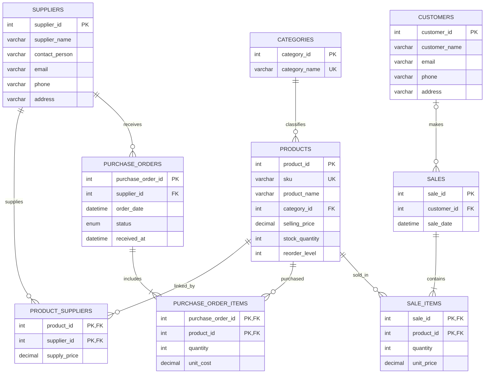

# Case 7 — Retail Store Entity Relationship Model

## Cardinality and design decisions

- One category has many products; each product belongs to one category.
- Suppliers and products are many-to-many through `product_suppliers`.
- A supplier has many purchase orders; each purchase order has one supplier and many line items.
- A product may appear on many purchase order lines and many sales lines.
- A customer may have many sales. A sale may have no customer record (walk-in customer).
- Each sale contains at least one product line.
- `sale_items.unit_price` and `purchase_order_items.unit_cost` store historical transaction prices, rather than using mutable current prices.
- `products.stock_quantity` stores the current on-hand balance, maintained through transaction-safe sales and purchase-order receipts.

## Relational schema (PK bold, FK in parentheses)

- CATEGORIES(**category_id**, category_name UNIQUE)
- PRODUCTS(**product_id**, sku UNIQUE, product_name, category_id (FK), selling_price, stock_quantity, reorder_level, created_at)
- SUPPLIERS(**supplier_id**, supplier_name, contact_person, email, phone, address)
- PRODUCT_SUPPLIERS(**product_id** (FK), **supplier_id** (FK), supply_price)
- PURCHASE_ORDERS(**purchase_order_id**, supplier_id (FK), order_date, status, received_at, notes)
- PURCHASE_ORDER_ITEMS(**purchase_order_id** (FK), **product_id** (FK), quantity, unit_cost)
- CUSTOMERS(**customer_id**, customer_name, email, phone, address)
- SALES(**sale_id**, customer_id (nullable FK), sale_date, notes)
- SALE_ITEMS(**sale_id** (FK), **product_id** (FK), quantity, unit_price)

All tables are InnoDB, with primary keys, foreign keys, and checks for price and quantity.
